<p align="center">
  
</p>

<p align="center">
  <a href="https://shakeelkhan.vercel.app"></a>
  <a href="https://www.linkedin.com/in/shakeelkhan8"></a>
  <a href="https://stripecertifications.credential.net/6bee55d8-4212-44c4-8355-5fbb9b9a712f"></a>
</p>

<br />

I'm a software engineer who works across TypeScript/Node.js and PHP/Laravel, from the database to the UI. I care most about the parts of a product that have to be right: payments that never run twice, ledgers that balance, and customer data that stays separate.

## Focus

<table>
  <tr><td><b>Payments</b></td><td>Gateway integrations with signed webhooks that stay correct when events arrive twice or out of order</td></tr>
  <tr><td><b>Ledgers</b></td><td>Double-entry accounting, idempotent postings and reconciliation that can be audited line by line</td></tr>
  <tr><td><b>Multi-tenant SaaS</b></td><td>Tenant isolation enforced by the database, not by remembering a <code>where</code> clause</td></tr>
  <tr><td><b>AI features</b></td><td>LLM features with schema-checked output, a safe fallback and a hard cost cap</td></tr>
</table>

## Stack

<p>
  
</p>

<table>
  <tr><td><b>Languages</b></td><td>TypeScript, JavaScript, PHP, SQL</td></tr>
  <tr><td><b>Backend</b></td><td>Node.js, NestJS, Express, Laravel, REST APIs, webhooks, BullMQ and Laravel queues</td></tr>
  <tr><td><b>Frontend</b></td><td>React, Next.js, Tailwind CSS</td></tr>
  <tr><td><b>Data</b></td><td>PostgreSQL, MySQL, Redis, Prisma, row-level security</td></tr>
  <tr><td><b>Delivery</b></td><td>Docker, AWS, GitHub Actions, OpenTelemetry</td></tr>
  <tr><td><b>Testing</b></td><td>Vitest, PHPUnit, Playwright, Testcontainers</td></tr>
</table>

## Featured work

<table>
  <tr>
    <td width="50%" valign="top">
      <h3>AI Mentor Health</h3>
      <p>A Laravel SaaS with Stripe subscriptions. Webhooks stay correct when events arrive twice or out of order, AI usage is capped per plan, and CI runs the suite on SQLite and PostgreSQL.</p>
      <p><code>Laravel</code> <code>PostgreSQL</code> <code>Stripe</code> <code>PHPUnit</code></p>
      <p><a href="https://github.com/Shakeelkhan8/ai-mentor-health"><b>Code</b></a> &nbsp;·&nbsp; <a href="https://shakeelkhan.vercel.app/projects/ai-mentor-health"><b>Case study</b></a></p>
    </td>
    <td width="50%" valign="top">
      <h3>Settlement Reconciliation Engine</h3>
      <p>Matches courier and payment-provider settlement files against expected payments. On a 400-line test set with 12 injected fault types it auto-matched 70% with zero wrong matches. An LLM proposes fixes for the rest.</p>
      <p><code>NestJS</code> <code>PostgreSQL</code> <code>BullMQ</code> <code>OpenTelemetry</code></p>
      <p><i>Private repository</i></p>
    </td>
  </tr>
  <tr>
    <td width="50%" valign="top">
      <h3>Portfolio</h3>
      <p>My personal site, with a content admin, a contact pipeline, accessibility checks and end-to-end tests in CI.</p>
      <p><code>Next.js</code> <code>TypeScript</code> <code>Supabase</code> <code>Playwright</code></p>
      <p><a href="https://shakeelkhan.vercel.app"><b>Live site</b></a> &nbsp;·&nbsp; <a href="https://shakeelkhan.vercel.app/projects/portfolio"><b>Case study</b></a></p>
    </td>
    <td width="50%" valign="top">
      <h3>Writing</h3>
      <p><a href="https://shakeelkhan.vercel.app/writing/designing-idempotent-webhooks-for-payments"><b>Payment webhooks arrive twice. Plan for it.</b></a><br />Why a webhook handler has to be safe to run more than once, and how to make it so.</p>
      <p><a href="https://shakeelkhan.vercel.app/writing/multi-tenant-data-isolation-in-saas"><b>One database, many companies</b></a><br />Making tenant scoping the default, so one customer can never see another's data.</p>
    </td>
  </tr>
</table>

## How I build

```text
Every bug fix ships with a test that fails without it.
Every handler is safe to run twice, because retries are normal.
Every tenant boundary is enforced by the database.
```
